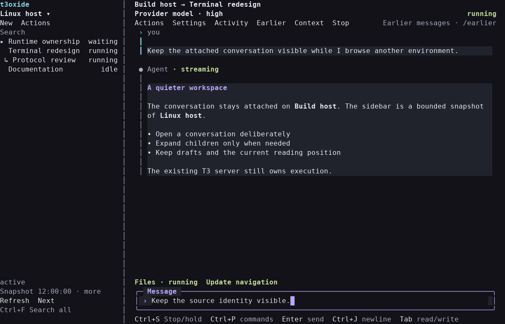
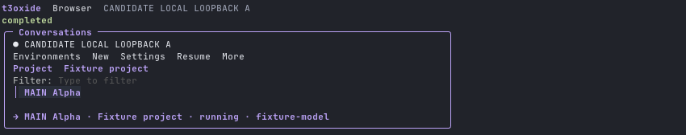
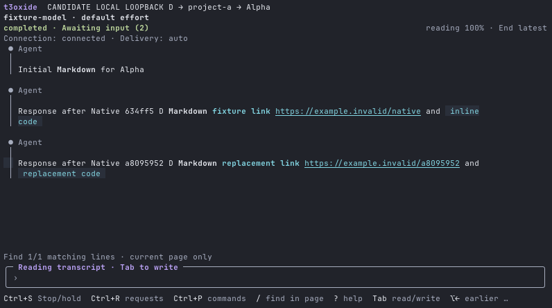

# t3oxide

A Go terminal client for existing [T3 Code](https://github.com/pingdotgg/t3code) environments, built directly with **Bubble Tea v2**, Bubbles, Lip Gloss and Glamour. Read conversations, send messages, answer questions and approvals, and stop a reviewed active turn from your terminal. This is the primary client; the Swift/AppKit app remains available as a legacy rollback.

```text
Go CLI / Bubble Tea TUI
  └─ SSH or local stdio
      └─ on-demand Node adapter → existing T3 server
```

## Build and install

Build with **Go 1.26.0+**. Each T3 host needs Node.js 22.4+ and the host adapter; remote profiles use your existing OpenSSH configuration. The primary CI artifact targets Apple Silicon macOS.

```sh
bash scripts/build-go.sh
./dist/t3oxide envs
./dist/t3oxide
```

Follow [installation](NATIVE.md) to prepare the host adapter and environment profiles, then [Go setup and controls](NATIVE-GO.md) to install the executable on your PATH. Distributions include `NOTICE` and `LICENSES/` alongside the binary. Installation does not install, upgrade, start or restart T3.

The client starts in the conversation browser. **Enter** opens a conversation. Wide terminals keep a conversation sidebar beside the attached transcript; **Ctrl+O** focuses it, while compact terminals use the full browser. **Tab / Shift+Tab** moves between visible panes. **Ctrl+P** opens Commands without changing editor text. Use `/help` for the active controls.

## Features

- A conversation sidebar with up to 24 unsettled root conversations per environment, explicit working-child expansion, lifecycle/type filters, broader search and paging. Browsing another environment preserves the attached conversation and its draft. Compact terminals retain the full browser.
- Bounded command/tool/file-change/subagent activity, with exact source-bound result inspection on demand and separate activity history. A tool burst cannot crowd readable messages out of their page.
- Clickable navigation and primary actions, focus-aware scrolling, and an optional responsive context pane. Mouse-off retains native terminal selection.
- Markdown transcript with stable reading anchors, native composer editing, slash completion and searchable commands with portable controls.
- One settings review for model and supported options, with searchable field choices and a single Apply. Question forms retain progress through Back/Next and validate before submission.
- Exact external editing and bounded prompt recall, including recoverable rejected code pastes and explicit clears.
- One New conversation review for the first message, title and supported local model/effort/tier choices in the selected existing workspace.
- Smaller latest pages, Earlier/Latest navigation, complete new-conversation drafts and explicit recovery of uncertain writes.
- Explicit lifecycle filters and bounded list continuation; optional versioned JSON output retains scope and completeness.
- Current-thread, next-message and supported launch settings from the selected provider's advertised capabilities.
- Human-authored messages with queue/steer intent, independent Stop with queue hold, request review and separate connection/run/receipt status.
- Per-environment appearance with distinct defaults, fixed violet/cyan/lime choices and a Terminal theme that inherits terminal colors. See [theme controls](NATIVE-GO.md#themes).
- Read-only `envs`, `threads`, `status`, `doctor`, `capabilities`, `activity` and `inspect` commands. New inspection commands return versioned JSON success/error envelopes; existing arrays remain compatible.

T3 owns providers, execution, durable conversations, queues and workspaces. The client keeps one detailed conversation attached; browsing other environments' lists uses temporary metadata helpers without opening their transcripts. Existing T3 work continues when the client disconnects. Results beyond the bounded inspector, attachment uploads, provider configuration and full-history search remain in T3. See [controls and launch scope](NATIVE-GO.md) and [model/navigation semantics](docs/model-navigation.md).

See [the 0.7 architecture decision and reuse map](docs/reuse-t3term.md) for the four alternatives, exact t3term ports, process ownership and migration contract.

## Screenshots

**0.7 workspace, 120×35.** Produced by the actual terminal model's `View` using synthetic state; this is a cell-accurate fixture rendering, not a native Mac capture. The sidebar browses Linux host while the main conversation remains attached to Build host.



[Compact 60×16 layout](docs/screenshots/workspace-60x16.png) · [Wide 170×40 context layout](docs/screenshots/workspace-170x40.png)

The following **historical 0.5.1** captures use Ghostty and synthetic demo conversations. Crops omit window chrome and unused margins.

**Conversation browser** — browse projects and conversations while keeping the active conversation attached.



**Reading and search** — Markdown, run/request status and highlighted matches on the current page.



## Development and CI

On an Apple Silicon Mac with Go 1.26.0+, Node 22.4+, Python 3 and Apple command-line developer tools:

```sh
bash scripts/check-go.sh
bash scripts/check.sh
bash scripts/check-security.sh
bash scripts/build-go.sh
```

The Go check script covers formatting, tests, vet and race detection. The shared check script retains adapter, script, measurement and available Swift checks. CI publishes the primary `t3oxide-terminal-macos-arm64` artifact and separately checks/builds the legacy Swift app as `t3oxide-legacy-swift-macos-arm64`.

See [architecture](docs/architecture.md), [Go implementation ownership](docs/go-terminal.md), [contributor instructions](AGENTS.md) and the [verification record](docs/verification.md) for pinned dependencies and recorded checks. The adapter targets T3 orchestration protocol 2; compatibility with future nightlies is not guaranteed. No RAM or battery savings are claimed without measurements.

## Legacy Swift rollback

The AppKit source remains in `mac/`. On an Apple Silicon Mac running macOS 14+ with Apple developer tools, build it with `bash scripts/build-mac.sh`. Outputs remain `dist/t3oxide.app` and `dist/t3oxide-macos-arm64.zip`; builds are ad-hoc signed and not notarized. See [legacy installation](NATIVE.md#legacy-swift-rollback).

Swift retains `~/.config/t3oxide/drafts.json`; Go uses the separate `go-drafts.json` and never edits the Swift file. Preserve both state files and host `operations-v1/` recovery journals. Returning to Swift does not transfer new Go drafts or pending actions; review unresolved work before changing clients.
