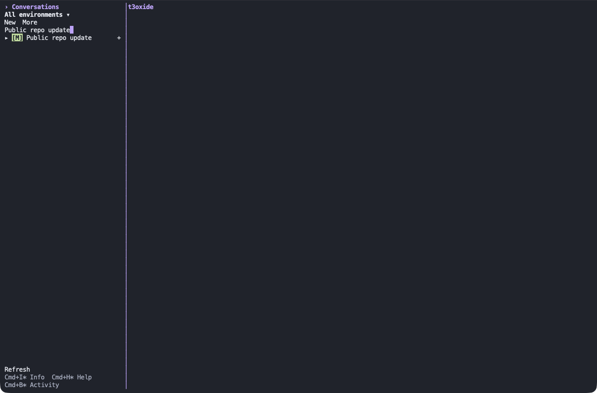
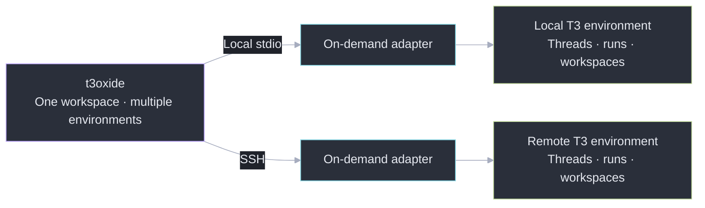
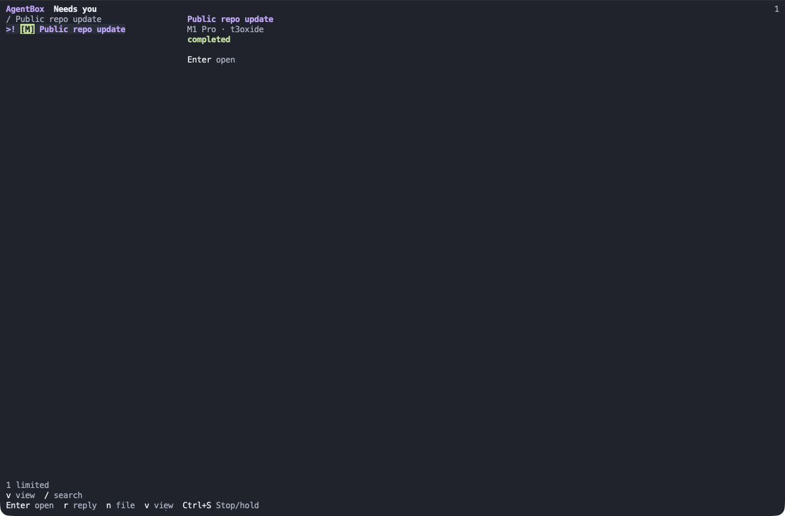
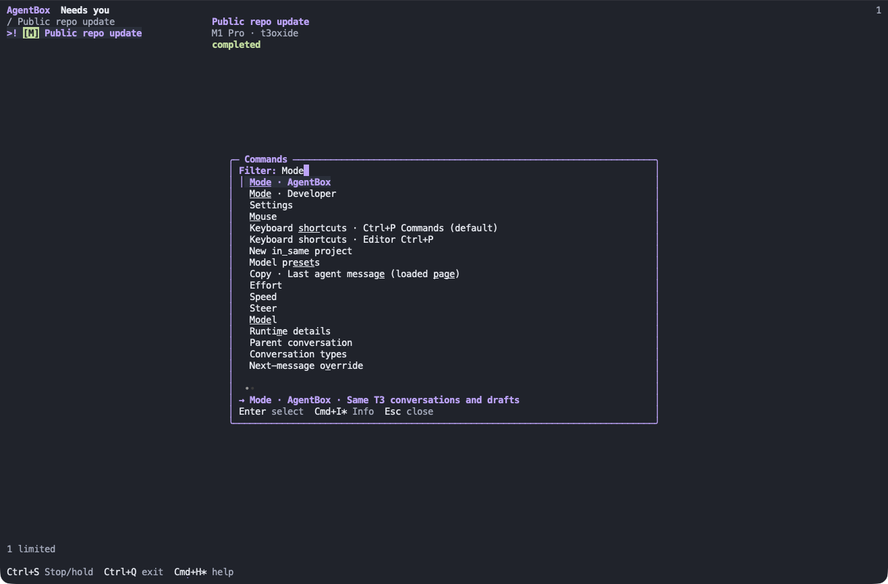
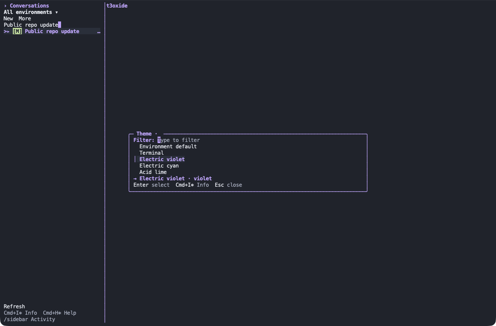

<h1 align="center">t3oxide</h1>

<p align="center">A terminal workspace for your existing T3 Code conversations and tasks.</p>



## Overview

Browse conversations across your configured [T3 Code](https://github.com/pingdotgg/t3code) environments, open a thread, and keep working from your terminal. **Developer** gives you a unified conversation browser. **AgentBox** turns those same threads into a task inbox.

T3 owns execution, permissions, threads, worktrees and queues. t3oxide connects through an on-demand Node adapter; closing the client leaves native work running. The primary client uses Go, Bubble Tea v2, Bubbles, Lip Gloss and Glamour. The retained Swift/AppKit client provides a separate rollback path.



## Features

### Find the right conversation

See configured environments together, ordered by recent native activity. Filter the list, then open the exact conversation with Enter or a click. Browsing does not subscribe to transcripts, and an unavailable host leaves healthy rows usable.

### Work with the conversation in view

Read streaming Markdown, compose a reply, inspect tools and changes, or answer a native request. Conversation and Info sidebars keep context close. Drafts, pending requests and operation identities survive supported returns; uncertain mutations require an explicit retry.

### Review tasks in AgentBox

Start with **Needs you**, then move between Working, Queued, Later, Reviewed, All and Unknown. **Completed** describes a run; **Reviewed** describes the native review disposition. File work into an existing project, review each launch, reply in its source conversation, and inspect native diffs and linked PRs. AgentBox defaults to native isolated worktrees.

Priorities organize the client view; they do not schedule work after exit. Existing native runs and accepted message queues continue independently. See the [AgentBox guide](docs/agentbox.md) for the full workflow.



### Switch modes without losing context

Open Commands to move between Developer and AgentBox. Both views use the same native conversations and drafts.



### Make the workspace yours

Use `/theme` or **Settings → Appearance** to choose an environment's theme. Violet, cyan and lime provide fixed palettes; Terminal follows your terminal's colours. Profile-specific choices persist without changing terminal settings. See [appearance and configuration](NATIVE-GO.md) for theme roles and launch overrides.




## Installation

Download [0.8.2 for Apple Silicon](https://github.com/Xon333/t3oxide/releases/tag/v0.8.2), or build from source:

Requirements: **Go 1.26.10+**, **Node 22.4+** on each adapter host, and an existing T3 instance. Remote profiles use your existing OpenSSH configuration.

```sh
git clone https://github.com/Xon333/t3oxide.git
cd t3oxide
bash scripts/build-go.sh
./dist/t3oxide envs
./dist/t3oxide
```

Follow [installation](NATIVE.md) to configure host adapters and environment profiles, then [Go setup](NATIVE-GO.md) for executable installation and appearance. Preserve existing profiles and drafts when updating.

Building the client does not install or restart T3. See [verification](docs/verification.md) for tested versions and known limits, and [native contracts](docs/native-workflows.md) for the adapter boundary.

## Usage

Developer is the default for a new settings file. Open **Commands → AgentBox** or enter `/mode agentbox` for the task inbox; `/mode developer` returns to conversation browsing.

| Action | Portable default |
| --- | --- |
| Commands | Ctrl+P or Ctrl+Space |
| Conversations / Info | Ctrl+O / Ctrl+L |
| Newline / Send | Enter / Ctrl+] |
| Literal send | Ctrl+\ |
| Stop with native queue hold | Ctrl+S, including over dialogs |
| Move focus / dismiss / exit | Tab or Shift+Tab / Esc / Ctrl+Q |
| AgentBox navigation | J/K or arrows, Enter, R reply, N file, V views |

Enter in the composer inserts a newline. Delivered Command equivalents are available on macOS; terminals and the OS may intercept them. The [complete shortcut reference](docs/shortcuts.md) covers context-specific controls, steering, distinct Enter combinations and the optional shortcut file.

## Development

```sh
bash scripts/check-go.sh
bash scripts/check.sh
bash scripts/check-security.sh
bash scripts/build-go.sh
```

The Go checks cover formatting, tests, vet and race detection. Shared checks cover the Node adapter, scripts, Python measurement tests and available Swift tools. Run the checks affected by your change; documentation changes need no app build.

Read [architecture](docs/architecture.md) for the protocol boundary, [state and recovery](docs/state-recovery.md) before changing persistence, and [verification](docs/verification.md) for portable tests versus installed-instance evidence. Remaining native acceptance is tracked in [native remainder](NATIVE-REMAINDER.md).

Third-party attribution is in [NOTICE](NOTICE) and [LICENSES/](LICENSES/). This repository has no top-level license grant; third-party notices do not establish a blanket license for t3oxide.

The visual feature walkthrough follows the layout of [LazyGit's README](https://github.com/jesseduffield/lazygit#readme), with original t3oxide prose.
