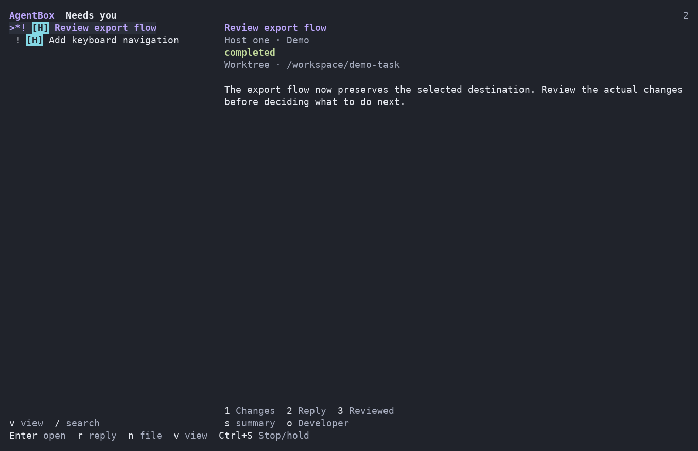

# t3oxide

A Go terminal client for existing [T3 Code](https://github.com/pingdotgg/t3code) environments, built with **Bubble Tea v2**, Bubbles, Lip Gloss and Glamour.

**Developer** opens a unified recent-conversation list across configured environments. Open a thread deliberately to read, compose, inspect tools, review requests or stop a run. **AgentBox** presents those same native threads as a task inbox: file work, prioritize your view, review changes, answer and return to the same conversation.

T3 owns execution, permissions, threads, worktrees and queues. The on-demand Node adapter translates bounded client operations. Closing the TUI leaves existing native work running. The Swift/AppKit client remains available as a separate rollback.

## Build and open

Requirements: Go **1.26.10+** for the client; Node **22.4+** on each adapter host. Remote profiles use your existing OpenSSH configuration.

```sh
bash scripts/build-go.sh
./dist/t3oxide envs
./dist/t3oxide
```

Use [installation](NATIVE.md) for host profiles and [Go setup](NATIVE-GO.md) for the executable. This source pass does not install, update or restart T3. Native integration of the new adapter extension is required before claiming installed support; see [native contracts](docs/native-workflows.md) and [verification](docs/verification.md).

## Developer

- All configured environments appear together, ordered by recent native activity. The right pane starts empty; arrows and filtering do not subscribe to transcripts. Enter or a click opens the exact environment/thread pair. An unavailable host leaves healthy rows usable.
- Stable project accents use filled markers, with text and selection cues. Info retains exact environment, project, thread, model, state and recovery details. At 60 columns navigation occupies the window when focused; at 80 columns and above it sits beside the conversation.
- New resolves target-native model, options and workspace policy, then uses an existing project. New in the same project carries only the project identity. First-thread projects work. When no configured creation target exists, the client asks because T3's desktop environment default is not exposed by its server API.
- Bounded tools, command results, file changes and children remain available on demand. Streaming Markdown retains reading anchors; exact drafts, selection, pending requests and operation identities survive supported returns.

## AgentBox

Use **Commands → AgentBox** or `/mode agentbox`; `/mode developer` returns. Developer is the default for a new settings file.

Needs you leads the inbox. Working, Queued, Later, Done, All and Unknown use actual native state. File one task or explicitly review a task list, choose an existing project and review every launch; AgentBox defaults to native isolated worktrees. Reply uses the ordinary source-bound composer. Requests use the existing exact approval/question forms. Changes shows real native diffs, changed files and linked PR metadata. Reviewed means a native visibility disposition, not a merge or proof of integration.

Project and task priorities organize this client's view. **Priority-driven future dispatch after exit is unavailable:** the verified native contract has no general one-shot priority backlog scheduler. Existing native runs and accepted native message queues continue independently. No additional scheduler, database, provider worker or always-running client process is installed. See the [AgentBox guide](docs/agentbox.md) for supported workflows and limits.

## Everyday controls

| Action | Portable default |
| --- | --- |
| Commands | Ctrl+P; Ctrl+Space also opens it |
| Conversations / Info | Ctrl+O / Ctrl+L |
| Newline / Send | Enter / Ctrl+] |
| Literal send | Ctrl+\; distinct Ctrl+Enter is also accepted |
| Steer this message | Commands → Steer; distinct Ctrl+Alt+Enter |
| Independent Stop with native queue hold | Ctrl+S, including over dialogs |
| Move focus / dismiss / exit | Tab or Shift+Tab / Esc / Ctrl+Q |
| AgentBox navigation | J/K or arrows, Enter, R reply, N file, V views |

Delivered Command equivalents are available on macOS. The terminal or OS may intercept them; no terminal settings are changed. Enter in the composer inserts a newline. Form confirmation and explicit request submission have their own controls. The [complete command/key reference](docs/shortcuts.md) documents contexts, portable alternatives and the optional startup-only shortcut file.

## Synthetic views

These captures come from the actual `Model.View()` with generic fixture data. They demonstrate cell layout, not physical-terminal or installed-host acceptance.




## Development

```sh
bash scripts/check-go.sh
bash scripts/check.sh
bash scripts/check-security.sh
bash scripts/build-go.sh
```

The Go script checks formatting, tests, vet and race detection. The shared script checks the Node adapter, scripts, Python measurement tests and available Swift tools. No new application dependency is added in this pass. [Architecture](docs/architecture.md), [state and recovery](docs/state-recovery.md), [native remainder](NATIVE-REMAINDER.md), and [verification](docs/verification.md) separate portable evidence from native acceptance.

Preserve `NOTICE`, `LICENSES/`, old releases and `operations-v1/`. Go uses `go-drafts.json`; Swift keeps its separate `drafts.json`. AgentBox behavior is independently authored after source research; no AgentBox GPL source, tests or assets are included. This snapshot has no top-level license grant; third-party notices do not establish a blanket license for t3oxide.
